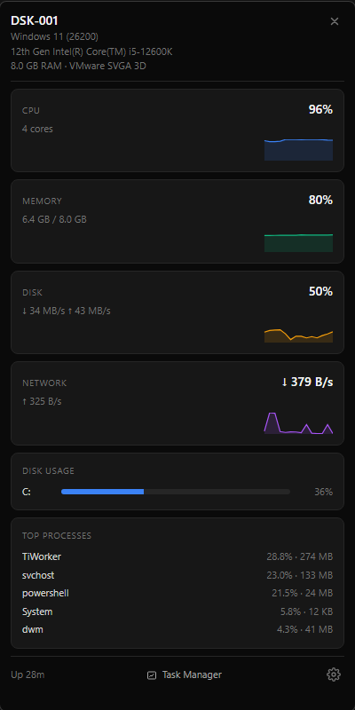

# System Monitor

A little tray app for Windows that shows what your PC is up to. Click the icon, glance at it, close it.

You get CPU, memory, disk and network with a 60-second graph each, how full your drives are, and the top 5 processes. That's it — no setup, no accounts, no internet connection.

It uses nothing while the popup is closed. No background polling, no timers — it only does work while you're actually looking at it.

## Install

1. Download `System.Monitor.Setup.1.0.0.exe` from the [Releases](../../releases) page.
2. Run it. It installs in under 30 seconds, no admin rights needed.
3. Look for the blue bar-chart icon in your system tray (you may need to click the `^` arrow to find it).

**"Windows protected your PC"?** That's expected — the installer isn't code-signed, so Windows flags it. Click **More info**, then **Run anyway**. The release page lists a SHA-256 checksum if you want to verify your download.

## Using it

- **Click the tray icon** to open the popup. Click it again (or the **X**) to close.
- **Hover over a graph** to see the value at any point in the last minute.
- **Drag the top of the popup** to move it.
- **Task Manager** button opens Task Manager when you need the full picture.
- **Gear icon** → turn on **Launch on login**, or **Quit**.

## Uninstall

Settings → Apps → System Monitor → Uninstall. It removes everything it created — no leftover files or registry entries.

## Requirements

Windows 10 or 11, 64-bit. English-language Windows for now (on other languages the graphs show "—").

## For developers

How it works, how to build it, and all the technical details: [docs/DEVELOPMENT.md](docs/DEVELOPMENT.md).

MIT licensed.
